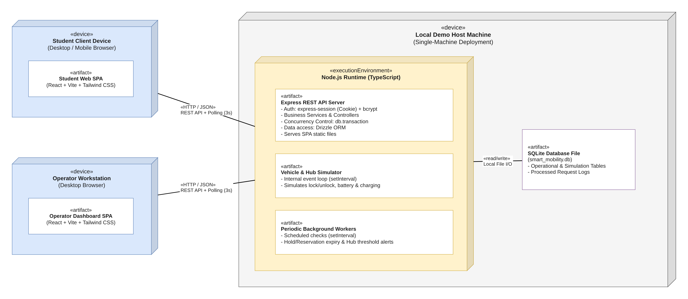

# Software Design Document (SDD)

> **Tài liệu đối chiếu chi tiết:** [ANH_XA_CLASS_DIAGRAM_CODE.md](submission-3/ANH_XA_CLASS_DIAGRAM_CODE.md) · [CONTRIBUTING.md](../CONTRIBUTING.md) · Phần III trong [L03_17.pdf](L03_17.pdf)

---

## 1. Kiến trúc tổng thể (4-Layer Architecture)

Hệ thống tổ chức theo mô hình **Client–Server SPA** kết hợp kiến trúc phân tầng nghiêm ngặt ở Backend:

```text
[React 18 + Vite + Leaflet SPA]
          │  REST JSON + Session Cookie (Polling 3s)
          ▼
  Route (URL, requireAuth, requireRole, validateBody)
          │
          ▼
  Controller (đọc req, currentUser, sendOk)
          │
          ▼
  Service (nghiệp vụ, db.transaction, idempotency, simulator)
          │
          ▼
  Repository (truy vấn đồng bộ Drizzle ORM)
          │
          ▼
  SQLite (better-sqlite3, WAL mode, foreign_keys = ON)
```

- **Tác vụ nền (`server/src/schedulers/` & `simulator/`):** `HoldExpiryScheduler`, `ReservationExpiryScheduler`, `HubAlertScheduler`, `VehicleSimulator`, và `SimulationEngine` (chỉ đọc `simulation_snapshots`, tách biệt hoàn toàn bảng vận hành).
- **Quy tắc bất biến:** Chữ ký public method của `Controller`, `Service`, `Repository` bám sát Class Diagram Submission #3.

## 2. Sơ đồ thiết kế UML (Submission #3)

Các sơ đồ gốc (`.drawio` và ảnh `.png`) được lưu trong `docs/submission-3/`:

| Sơ đồ | Ảnh minh họa | File nguồn |
| --- | --- | --- |
| **Deployment Diagram** | [deployment-diagram.png](submission-3/mtriet-submission3/PNGs/deployment-diagram.png) | [deployment-diagram.drawio](submission-3/mtriet-submission3/Draw-io/deployment-diagram.drawio) |
| **Package Diagram** | [packagediagram.png](submission-3/hoangnhan_submission3/png/packagediagram.png) | [packagediagram.drawio](submission-3/hoangnhan_submission3/packagediagram.drawio) |
| **Class Diagram tổng thể** | [class-tong-the.png](submission-3/quangnhan/class-tong-the.png) | [class-tong-the.drawio](submission-3/quangnhan/class-tong-the.drawio) |
| **Phân hệ Tài khoản & Đỗ/Trả xe (UC05, UC06)** | [class-do-xe-tra-xe.png](submission-3/quangnhan/class-do-xe-tra-xe.png) | [class-tai-khoan-do-xe.drawio](submission-3/quangnhan/class-tai-khoan-do-xe.drawio) |
| **Phân hệ Xe dùng chung & Điều chuyển (UC02–04, UC12)** | [class-dat-xe-nhan-xe.png](submission-3/quoclinh/png/class-dat-xe-nhan-xe.png) · [class-dieu-chuyen-giam-sat.png](submission-3/quoclinh/png/class-dieu-chuyen-giam-sat.png) | [class-xe-dung-chung-fixed.drawio](submission-3/quoclinh/class-xe-dung-chung-fixed.drawio) |
| **Phân hệ Tìm kiếm, Sạc & Sự cố (UC01, UC07, UC08, UC11)** | [UC01.png](submission-3/mtriet-submission3/PNGs/UC01.png) · [UC07.png](submission-3/mtriet-submission3/PNGs/UC07.png) · [UC08.png](submission-3/mtriet-submission3/PNGs/UC08.png) · [UC11.png](submission-3/mtriet-submission3/PNGs/UC11.png) | `submission-3/mtriet-submission3/Draw-io/` |
| **Phân hệ Đổi lịch sạc, Giám sát & Mô phỏng (UC09, UC10, UC13, UC14)** | [UC09.png](submission-3/hoangnhan_submission3/png/UC09.png) · [UC10.png](submission-3/hoangnhan_submission3/png/UC10.png) · [UC13.png](submission-3/hoangnhan_submission3/png/UC13.png) · [UC14.png](submission-3/hoangnhan_submission3/png/UC14.png) | `submission-3/hoangnhan_submission3/` |



## 3. Thiết kế cơ sở dữ liệu (`server/src/db/schema.ts`)

CSDL SQLite gồm **20 bảng** quản lý qua Drizzle ORM. Các entity vận hành dùng UUID `id`, còn `processed_requests` dùng khóa chính `request_id`. Cột ngày giờ dùng `timestamp_ms`.

| Nhóm | Các bảng | Ràng buộc / Ghi chú chính |
| --- | --- | --- |
| **Tài khoản** | `users`, `private_vehicles` | `users.email` unique; mật khẩu lưu dạng `password_hash` (bcrypt). |
| **Hub & Tài nguyên** | `hubs`, `parking_slots`, `charging_ports`, `shared_vehicles` | `parking_slots (hub_id, code)` unique; `charging_ports.slot_id` unique (cổng sạc nằm trong chỗ đỗ, không cộng thêm sức chứa). |
| **Xe dùng chung** | `vehicle_reservations`, `trips` | `trips.reservation_id` unique; index theo `student_id`. |
| **Đỗ xe** | `parking_allocations` | Lưu chung trạng thái giữ tạm (`HELD`), xác nhận (`CONFIRMED`), đang trả xe (`IN_USE`); index `(slot_id, start_time, end_time)`. |
| **Sạc xe** | `charging_requests`, `charging_reservations`, `charging_sessions`, `charging_schedule_versions` | `charging_reservations.version` & `charging_schedule_versions.version` dùng cho optimistic locking (UC09, UC13). |
| **Vận hành & Mô phỏng** | `incidents`, `alerts`, `redistribution_orders`, `redistribution_items`, `simulation_snapshots`, `simulation_runs` | `incidents.version` (optimistic locking); `simulation_snapshots` chụp trạng thái vận hành độc lập cho UC14. |
| **Idempotency** | `processed_requests` | Khóa chính `request_id`; ghi cùng transaction để chống thực thi lặp cho 22 thao tác ghi (`REQUEST_OPERATIONS`). |

## 4. Tóm tắt API Endpoints (`server/src/routes/index.ts`)

Tất cả endpoint có tiền tố `/api` và trả về JSON thống nhất `{ ok: true, data }` hoặc `{ ok: false, error: { code, message } }`:

| Prefix | Nhóm chức năng | Quyền truy cập |
| --- | --- | --- |
| `/api/health` | Kiểm tra trạng thái server | Công khai |
| `/api/auth` | Đăng ký, đăng nhập, đăng xuất, thông tin cá nhân, đổi theme, danh sách xe cá nhân | Công khai / Đã đăng nhập |
| `/api/hubs` | Xem danh sách & chi tiết trạng thái các Hub | Đã đăng nhập |
| `/api/me` | Xem danh sách lượt đặt của sinh viên hiện tại | `STUDENT` |
| `/api/search` | Tìm kiếm phương án di chuyển phù hợp (UC01) | `STUDENT` |
| `/api/vehicle-reservations` | Xem xe khả dụng, chuẩn bị/xác nhận/hủy đặt xe (UC02, UC03) | `STUDENT` |
| `/api/trips` | Nhận xe (UC04), xem chuyến hiện tại, trả xe (UC05) | `STUDENT` |
| `/api/parking` | Tìm chỗ đỗ, giữ chỗ tạm, xác nhận/hủy đặt chỗ (UC06) | `STUDENT` |
| `/api/charging-requests` | Yêu cầu sạc ngay / xếp hàng đợi / hủy yêu cầu (UC07) | `STUDENT` |
| `/api/charging-reservations` | Đặt lịch sạc (UC08), đổi/hủy lịch sạc (UC09) | `STUDENT` |
| `/api/monitoring` | Giám sát mạng lưới, KPI, cảnh báo Hub (UC10) | `OPERATOR` |
| `/api/incidents` | Ghi nhận, đánh giá, xử lý và đóng sự cố (UC11) | `OPERATOR` |
| `/api/redistribution-orders` | Xem phương án & thực thi điều chuyển xe giữa các Hub (UC12) | `OPERATOR` |
| `/api/charging-schedules` | Tạo, xem trước và áp dụng lịch sạc thông minh (UC13) | `OPERATOR` |
| `/api/simulations` | Chụp snapshot, chạy mô phỏng What-if & xem khuyến nghị (UC14) | `OPERATOR` |
