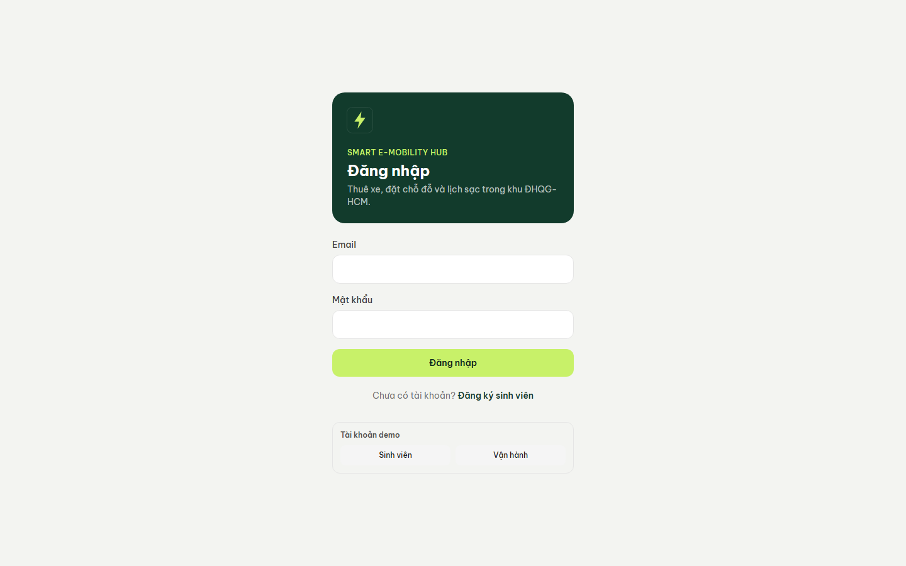
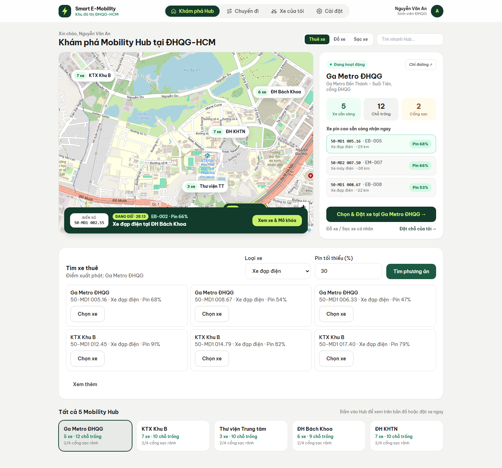
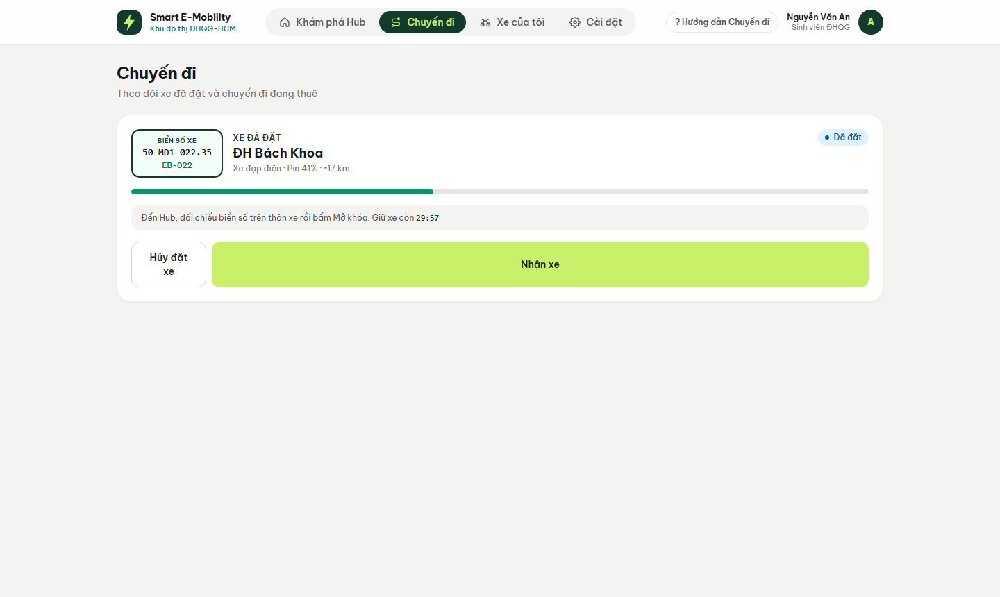
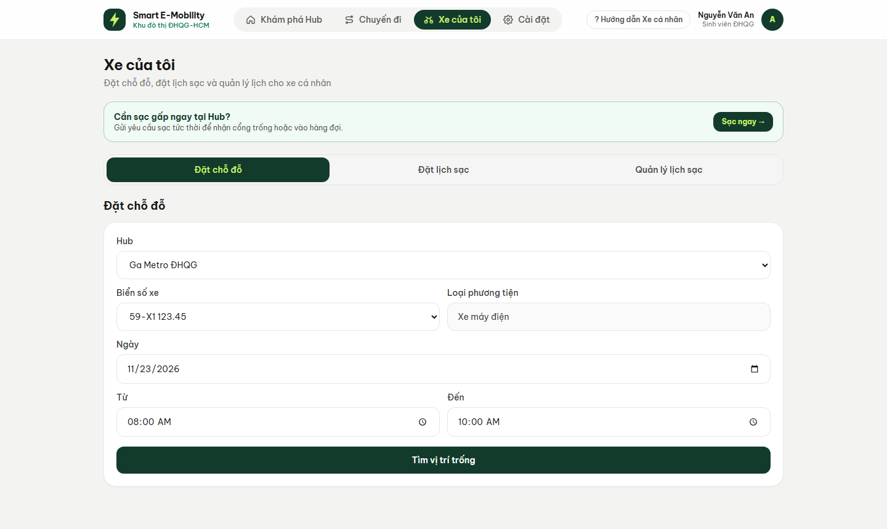
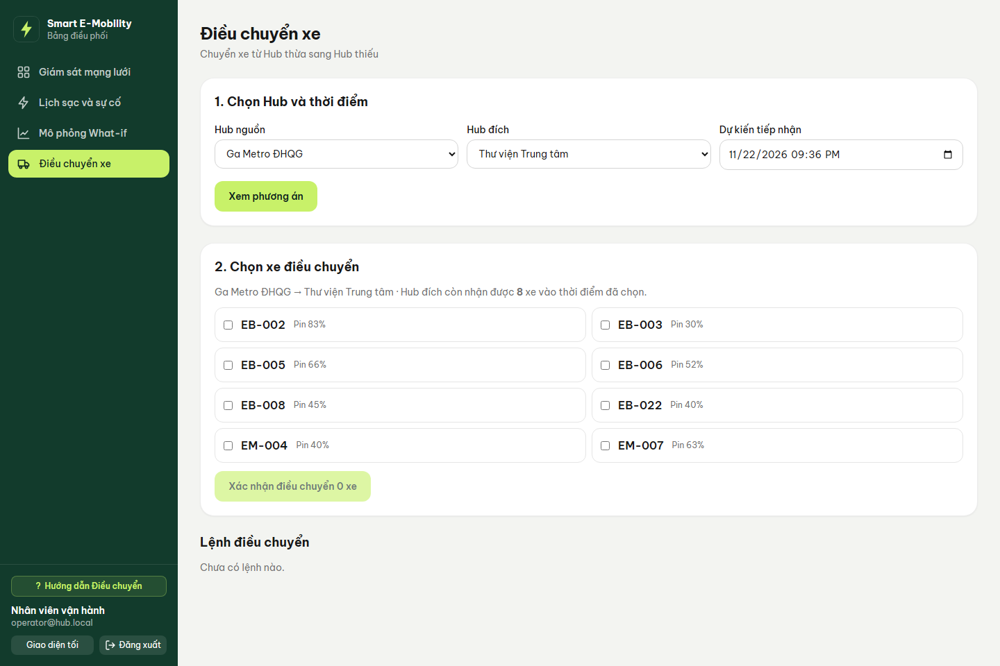

# User’s Manual — Hướng dẫn cài đặt & sử dụng

Tài liệu hướng dẫn cài đặt, khởi chạy và sử dụng hệ thống **Smart E-Mobility Hub** cho hai vai trò **Student (Sinh viên)** và **Operator (Nhân viên vận hành)**.

---

## 1. Cài đặt & Khởi chạy hệ thống

### 1.1 Yêu cầu môi trường
- **Node.js 24 LTS** và kết nối npm registry để tải thư viện.
- Không cần cài đặt cơ sở dữ liệu ngoài: hệ thống dùng SQLite cục bộ (`better-sqlite3` có sẵn bản biên dịch Node-API cho Windows, macOS và Linux).

### 1.2 Các bước chạy Local
```bash
npm ci             # Cài theo ba lockfile, tự tạo server/.env nếu thiếu
npm run db:reset   # Khởi tạo schema SQLite và nạp dữ liệu mẫu (5 Hub ĐHQG-HCM)
npm run dev        # Khởi chạy Backend (cổng 3000) và Frontend (cổng 5173)
```
Mở **<http://localhost:5173>** hoặc địa chỉ Local Vite in ra nếu cổng 5173 bận. Cổng 3000 phải trống. Lệnh `db:reset` xóa và tạo lại dữ liệu demo.

### 1.3 Mở thử trên điện thoại (cùng mạng Wi-Fi / LAN)
1. Kết nối máy tính và điện thoại vào cùng mạng Wi-Fi.
2. Chạy `npm run dev` và xem địa chỉ `Network:` do Vite in ra (ví dụ `http://192.168.1.5:5173`).
3. Mở địa chỉ đó trên trình duyệt điện thoại (nếu Windows Firewall hỏi, chọn **Allow**). Giao diện Student tự động chuyển sang bố cục ứng dụng di động (thanh tab dưới đáy).

### 1.4 Tài khoản demo mặc định

| Vai trò | Email | Mật khẩu | Ghi chú |
| --- | --- | --- | --- |
| **Operator** | `operator@hub.local` | `operator123` | Quản trị mạng lưới 5 Hub |
| **Student 1** | `student1@hub.local` | `student123` | Có sẵn xe cá nhân để thử đỗ/sạc |
| **Student 2** | `student2@hub.local` | `student123` | Đang có sẵn chuyến đi để thử trả xe (UC05) |



---

## 2. Hướng dẫn sử dụng — Vai trò Sinh viên (Student)

1. **Khám phá bản đồ Hub & Tìm phương án (Trang chủ / UC01):**
   - Xem trực tiếp 5 Mobility Hub tại ĐHQG-HCM trên bản đồ thời gian thực (tự đồng bộ mỗi 3 giây), chọn Hub để xem nhanh top 3 xe pin cao nhất kèm biển số.
   - Chuyển sang bộ lọc **Tìm phương án phù hợp (UC01)** để lọc theo loại xe và mức pin tối thiểu.

   
   

2. **Đặt, Hủy đặt, Nhận và Trả xe dùng chung (UC02–UC05):**
   - Từ **Khám phá Hub**, chọn Hub rồi mở trang **Đặt xe (`/student/hubs/:hubId/reserve`)**. Chọn xe khả dụng theo biển số, mã đội xe và mức pin, rồi bấm xác nhận giữ xe.
   - Tại trang **Chuyến đi (`/student/trips`)**, theo dõi đồng hồ đếm ngược giữ xe, có thể **Hủy đặt xe (UC03)**, **Mở khóa nhận xe (UC04)** hoặc **Trả xe về Hub đích (UC05)**.

   
   
   
   

3. **Xe cá nhân — Đặt chỗ đỗ & Lịch sạc (UC06–UC09):**
   - Tại trang **Xe của tôi (`/student/my-vehicle`)**: chọn xe cá nhân, Hub và khung giờ để **giữ tạm & xác nhận chỗ đỗ (UC06)**, **đặt lịch sạc trước (UC08)** hoặc **đổi/hủy lịch sạc (UC09)**.
   - Tại trang **Sạc ngay (`/student/charging-request`)**: gửi yêu cầu sạc tức thời tại Hub hoặc vào hàng đợi kèm thời gian chờ ước tính (**UC07**).

   
   

4. **Tùy chỉnh giao diện:** Vào mục **Cài đặt** để chuyển chế độ **Sáng / Tối / Theo hệ thống** (tùy chọn được lưu trên server cho tài khoản).

---

## 3. Hướng dẫn sử dụng — Vai trò Nhân viên vận hành (Operator)

1. **Giám sát mạng lưới (UC10 — `/operator/monitoring`):**
   - Theo dõi 4 chỉ số KPI tổng quan, bản đồ 5 Hub (Hub có cảnh báo hiển thị nổi bật), danh sách cảnh báo theo ngưỡng và bảng tình trạng chi tiết từng Hub.

   

2. **Lịch sạc thông minh & Xử lý sự cố (UC13, UC11 — `/operator/charging-incidents`):**
   - Tạo, xem trước và áp dụng phiên bản lịch sạc tối ưu cho từng Hub (**UC13**).
   - Ghi nhận sự cố thiết bị/xe, cập nhật phương án xử lý và đóng sự cố để khôi phục dịch vụ (**UC11**).

   

3. **Điều chuyển xe giữa các Hub (UC12 — `/operator/redistribution`):**
   - Chọn Hub nguồn, Hub đích và thời gian dự kiến (ETA) → hệ thống kiểm tra sức chứa tiếp nhận → chọn danh sách xe cần điều chuyển và tạo lệnh.

   

4. **Mô phỏng tình huống What-if (UC14 — `/operator/simulation`):**
   - Chụp bản trạng thái vận hành độc lập (snapshot), chọn kịch bản biến động nhu cầu/sự cố và chạy mô phỏng để so sánh KPI cơ sở vs kịch bản kèm khuyến nghị điều phối.

   
