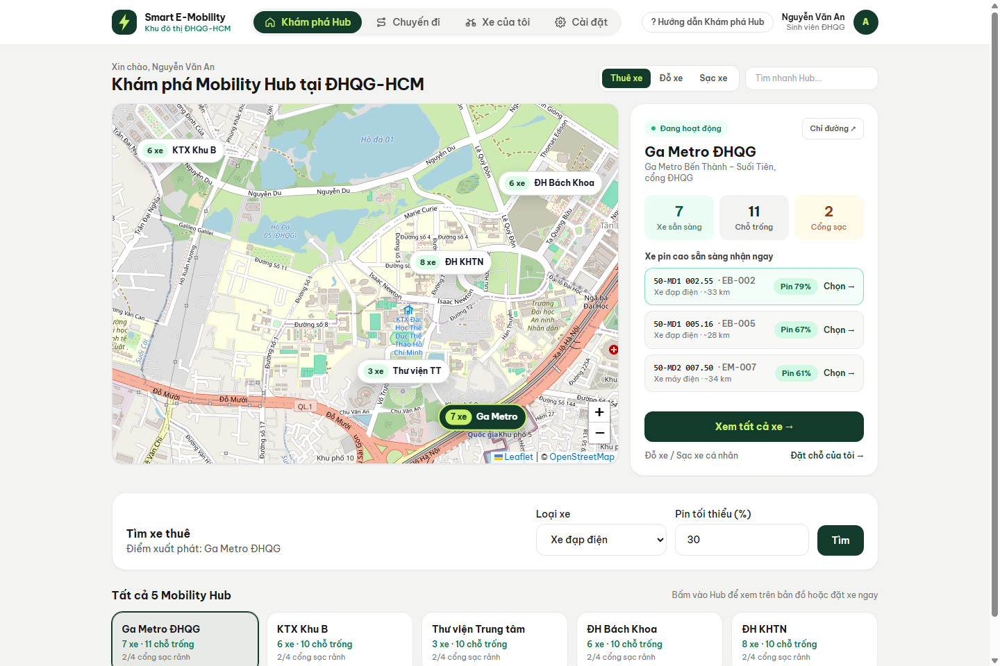
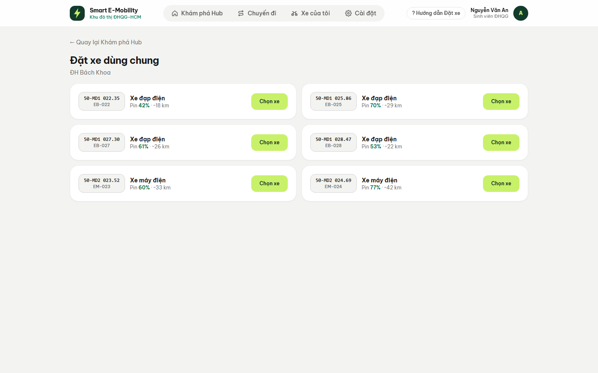
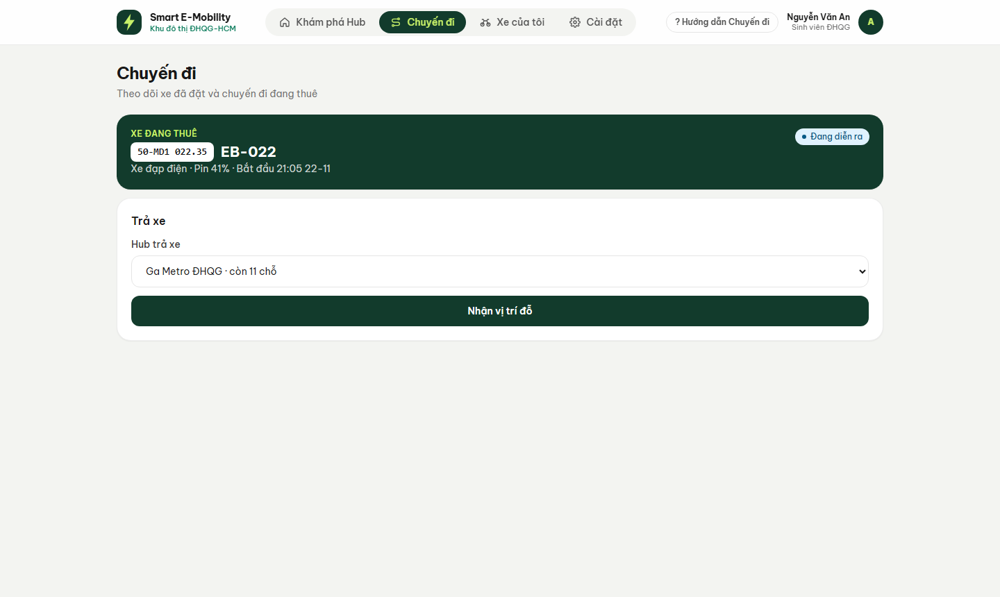
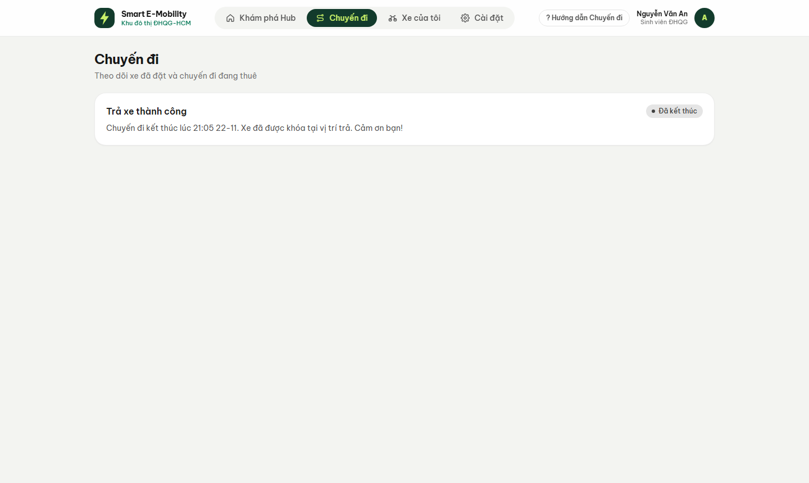
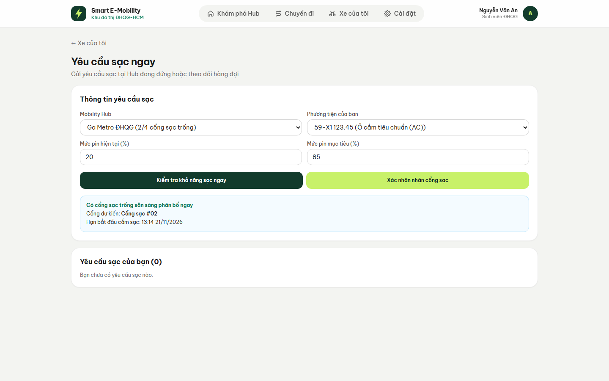
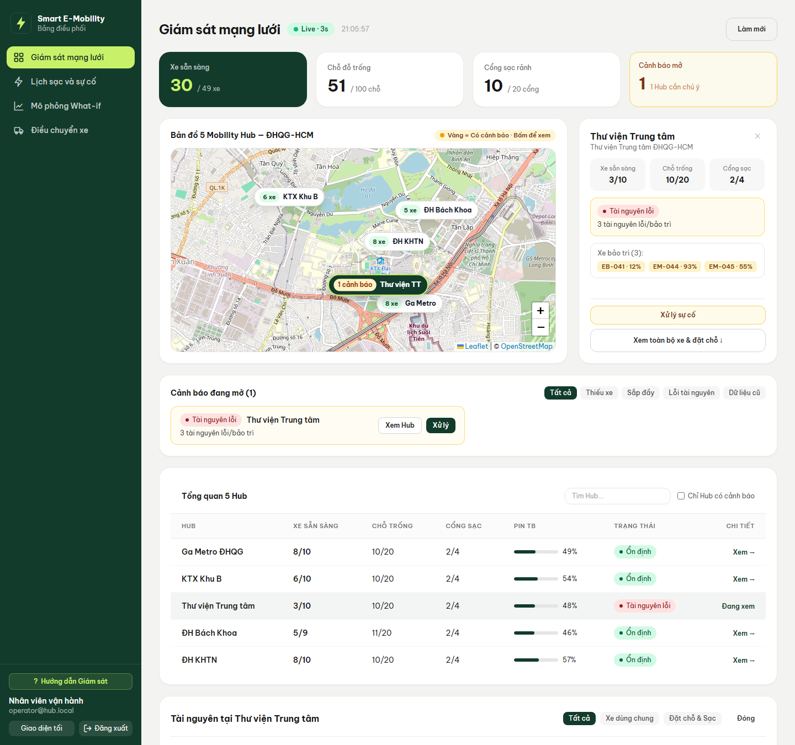
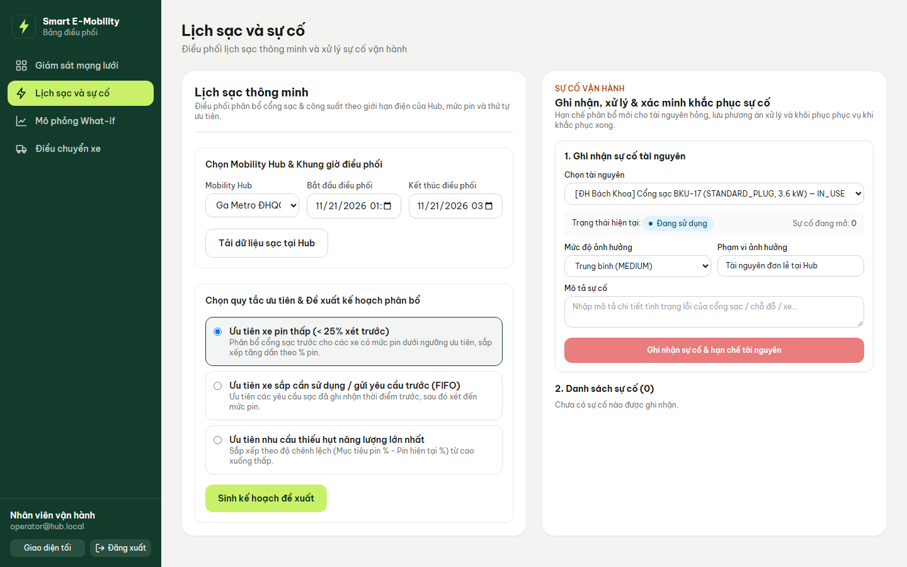
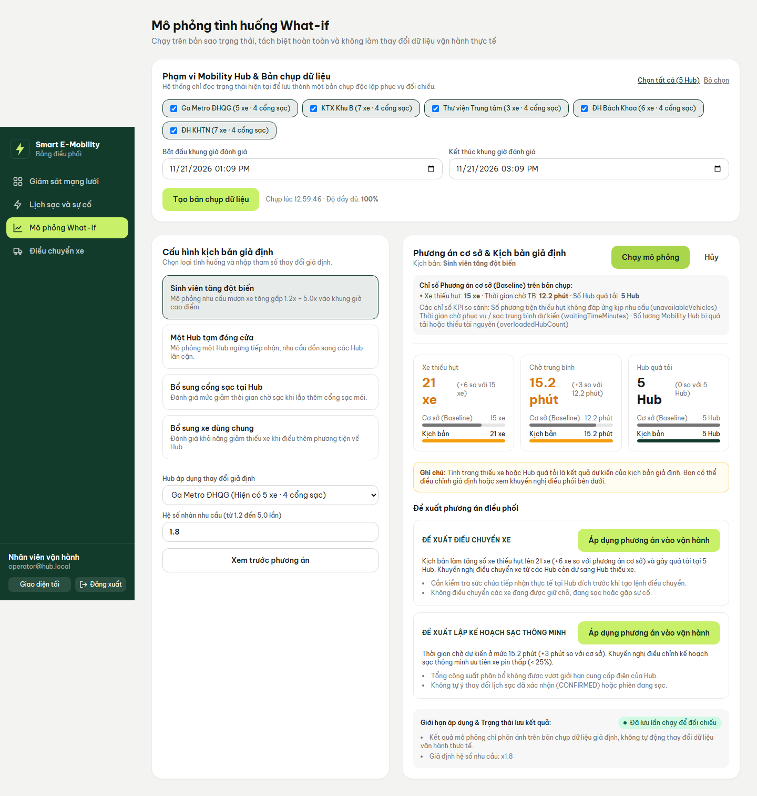

# User’s Manual — Hướng dẫn sử dụng & Phân tích Use Cases

Tài liệu hướng dẫn cài đặt, khởi chạy, thao tác từng màn hình kèm **phân tích ánh xạ trực tiếp sang 14 Use Cases (UC01–UC14) và 3 tác vụ nền (2.3.1–2.3.3)** của hệ thống **Smart E-Mobility Hub** (CO3001 – HK261 – Nhóm 17).

---

## 1. Cài đặt, Khởi chạy & Hướng dẫn nhanh lần đầu

### 1.1 Yêu cầu môi trường
- **Node.js 24 LTS** (tối thiểu Node 22.13+) và kết nối npm registry để tải thư viện.
- Không cần cài đặt cơ sở dữ liệu ngoài: hệ thống dùng SQLite cục bộ (`better-sqlite3` có sẵn bản biên dịch Node-API cho Windows, macOS và Linux).

### 1.2 Các bước chạy Local
```bash
npm ci             # Cài theo ba lockfile, tự tạo server/.env nếu thiếu
npm run db:reset   # Khởi tạo schema SQLite và nạp dữ liệu mẫu (5 Hub ĐHQG-HCM)
npm run dev        # Khởi chạy Backend (cổng 3000) và Frontend (cổng 5173)
```
Mở **<http://localhost:5173>** (hoặc địa chỉ Local Vite in ra nếu cổng 5173 bận; cổng 3000 phải trống). Lệnh `db:reset` xóa và tạo lại bộ dữ liệu mẫu cố định gồm **5 Hub, 100 chỗ đỗ, 20 cổng sạc, 50 xe dùng chung và 3 tài khoản demo**.

### 1.3 Mở thử trên điện thoại (cùng mạng Wi-Fi / LAN)
1. Kết nối máy tính và điện thoại vào cùng mạng Wi-Fi.
2. Chạy `npm run dev` và xem địa chỉ `Network:` do Vite in ra (ví dụ `http://192.168.1.5:5173`).
3. Mở địa chỉ đó trên trình duyệt điện thoại (nếu Windows Firewall hỏi, chọn **Allow**). Giao diện Student tự động chuyển sang bố cục ứng dụng di động (thanh tab dưới đáy).

### 1.4 Tài khoản demo mặc định (Auth: Sign In / Register)

| Vai trò | Email | Mật khẩu | Trạng thái dữ liệu mẫu sẵn có |
| --- | --- | --- | --- |
| **Operator** | `operator@hub.local` | `operator123` | Quản trị toàn mạng lưới 5 Hub ĐHQG-HCM |
| **Student 1** | `student1@hub.local` | `student123` | Có xe cá nhân `59-X1 123.45` + 1 lịch sạc mẫu `cr-demo-01` (dùng thử UC01–UC04, UC06–UC09) |
| **Student 2** | `student2@hub.local` | `student123` | Có sẵn 1 chuyến đi `ACTIVE` (dùng thử ngay UC05 Trả xe) |

> Trang đăng nhập ở chế độ dev có sẵn nút điền nhanh tài khoản demo. Sinh viên mới cũng có thể tự đăng ký tại `/register` (**Register Student Account**).


### 1.5 Hướng dẫn tương tác lần đầu theo từng màn hình (Interactive Tour kiểu Intro.js)
- Ngay lần đầu mở **bất kỳ màn hình hoặc tab chức năng nào** ở cả vai trò **Student** (Khám phá Hub, Đặt xe, Chuyến đi, Xe của tôi, Sạc ngay, Đặt chỗ của tôi, Cài đặt) lẫn **Operator** (Giám sát mạng lưới, Lịch sạc thông minh, Xử lý sự cố, Điều chuyển xe, Mô phỏng What-if), ứng dụng tự động bật **Onboarding Tour riêng của đúng trang đó** với khung spotlight chỉ thẳng vào từng vùng thao tác và gắn nhãn mã Use Case tương ứng.
- Trạng thái đã xem được lưu riêng theo từng trang trong `localStorage` để không lặp lại ở các lần truy cập sau.
- Bất cứ lúc nào muốn xem lại hướng dẫn của trang hiện tại, bấm nút **`? Hướng dẫn <tên trang>`** trên thanh menu (Student desktop), nút tròn **`?`** góc dưới phải (Student mobile), hoặc nút **`? Hướng dẫn ...`** ở góc dưới sidebar (Operator); hỗ trợ phím tắt `→` / `←` / `Esc`.

---

## 2. Bảng tổng hợp ánh xạ: Màn hình ↔ Use Case trong bài

| Vai trò | Màn hình / Đường dẫn | Mã Use Case | Chức năng dùng để làm gì? |
| --- | --- | --- | --- |
| **Chung** | `/login`, `/register`, `/student/settings` | Auth & Customize Theme | Đăng ký sinh viên, đăng nhập/đăng xuất, đổi giao diện Sáng / Tối / Theo hệ thống. |
| **Student** | `/student` (Khám phá Hub) | **View Hub Status**, **UC01** | Xem trạng thái 5 Hub trực tiếp trên bản đồ ĐHQG-HCM (3s/lần) và lọc phương án thuê xe / đỗ xe / sạc xe phù hợp. |
| **Student** | `/student/hubs/:hubId/reserve` | **UC02** | Chọn xe dùng chung khả dụng tại Hub và giữ xe trước trong 30 phút (chống đặt trùng). |
| **Student** | `/student/trips` (Chuyến đi) | **UC03, UC04, UC05** | Hủy lượt đặt còn hạn (UC03), mở khóa nhận xe bắt đầu chuyến đi (UC04), và trả xe về Hub đích có chỗ trống (UC05). |
| **Student** | `/student/reservations` | **View My Reservations** | Xem tập trung toàn bộ lượt đặt xe, đặt chỗ đỗ và lịch sạc hiện có của sinh viên. |
| **Student** | `/student/my-vehicle` (Xe của tôi) | **UC06, UC08, UC09** | Quản lý xe cá nhân: giữ tạm & xác nhận chỗ đỗ (UC06), đặt lịch sạc trước (UC08), đổi giờ hoặc hủy lịch sạc (UC09). |
| **Student** | `/student/charging-request` | **UC07** | Gửi yêu cầu sạc tức thời tại Hub (nhận cổng ngay hoặc vào hàng đợi có thời gian chờ dự kiến). |
| **Operator** | `/operator/monitoring` | **UC10** | Giám sát KPI mạng lưới 5 Hub thời gian thực, bấm trực tiếp pin vàng trên bản đồ để xem ngay cảnh báo/sự cố và chuyển nhanh sang xử lý. |
| **Operator** | `/operator/charging-incidents` (Tab 1) | **UC13** | Điều phối lịch sạc thông minh theo 3 bước (Hub/Khung giờ → Quy tắc ưu tiên → Kiểm tra tải điện kW & Áp dụng). |
| **Operator** | `/operator/charging-incidents?tab=incidents` (Tab 2) | **UC11** | Ghi nhận sự cố tài nguyên, hạn chế phân bổ mới, lập phương án xử lý và xác minh khắc phục để mở lại dịch vụ. |
| **Operator** | `/operator/redistribution` | **UC12** | Tạo lệnh điều chuyển xe từ Hub dư sang Hub thiếu, giữ trước sức chứa Hub đích và xác nhận xuất phát/tiếp nhận. |
| **Operator** | `/operator/simulation` | **UC14** | Mô phỏng tình huống What-if (tăng nhu cầu, đóng Hub, thêm cổng sạc/xe) trên bản chụp độc lập, so sánh KPI Trước/Sau và chuyển sang hành động. |
| **Hệ thống** | Schedulers chạy nền | **2.3.1, 2.3.2, 2.3.3** | Tự động giải phóng giữ chỗ quá hạn, hủy đặt xe quá hạn nhận, và đánh giá cảnh báo Hub định kỳ mỗi 15 giây. |

---

## 3. Hướng dẫn sử dụng chi tiết — Vai trò Sinh viên (Student)

### 3.1 Khám phá bản đồ Hub & Tìm phương án phù hợp (`View Hub Status` + `UC01`)
- **Đường dẫn:** `/student`
- **Thuộc Use Case nào:** **View Hub and Resource Status** (xem trạng thái trực tiếp 5 Hub) và **UC01 — Find Suitable Mobility Option** (tìm phương án di chuyển/đỗ/sạc phù hợp tiêu chí).
- **Cách sử dụng:**
  1. Trên bản đồ ĐHQG-HCM (tự cập nhật mỗi 3 giây), bấm vào bất kỳ pin Hub nào (*Ga Metro ĐHQG, ĐH Bách Khoa, Thư viện Trung tâm, ĐH KHTN, KTX Khu B*) để xem ngay số xe rảnh, chỗ trống, cổng sạc và top 3 xe pin cao nhất.
  2. Mở khung **Tìm phương án phù hợp (UC01)**, chọn loại dịch vụ / loại xe (`Xe đạp điện`, `Xe máy điện`) và mức pin tối thiểu → bấm **Tìm phương án** → chọn trực tiếp phương án phù hợp để chuyển sang bước đặt.




---

### 3.2 Đặt xe dùng chung (`UC02`)
- **Đường dẫn:** `/student/hubs/:hubId/reserve`
- **Thuộc Use Case nào:** **UC02 — Reserve Shared Vehicle** (giữ trước một xe điện dùng chung còn khả dụng và đủ ngưỡng pin tối thiểu ≥ 30%).
- **Cách sử dụng:**
  1. Từ trang chủ chọn một Hub → bấm **Đặt xe tại Hub này**.
  2. Chọn chiếc xe mong muốn (hiển thị mã xe, loại xe, % pin) → kiểm tra hạn giữ xe **30 phút** → bấm **Xác nhận đặt xe**.
  3. Hệ thống bọc giao dịch trong `db.transaction` kèm `requestId` để chống cấp trùng cùng một xe cho 2 sinh viên.



---

### 3.3 Hủy đặt, Mở khóa nhận xe & Trả xe dùng chung (`UC03`, `UC04`, `UC05`)
- **Đường dẫn:** `/student/trips`
- **Thuộc Use Case nào:**
  - **UC03 — Cancel Vehicle Reservation:** Hủy lượt đặt còn hạn, giải phóng xe ngay về `AVAILABLE`.
  - **UC04 — Pick Up Shared Vehicle:** Gửi lệnh mở khóa qua `VehicleSimulator`, chuyển xe sang `IN_USE` và mở chuyến đi `ACTIVE` (xử lý cả nhánh thiết bị `FAILED` / `UNKNOWN`).
  - **UC05 — Return Shared Vehicle:** Chọn Hub đích → cấp chỗ đỗ trống (không lấy ô có cổng sạc) → gửi lệnh khóa xe và kết thúc chuyến đi.
- **Cách sử dụng:**
  1. Khi đang có lượt giữ xe: xem đồng hồ đếm ngược 30 phút → bấm **Hủy đặt xe (UC03)** nếu đổi ý, hoặc bấm **Nhận xe → Mở khóa và nhận xe (UC04)** để bắt đầu hành trình.
  2. Khi đang trong chuyến đi: chọn Hub muốn trả → bấm **Chuẩn bị trả xe** (giữ 1 ô đỗ trống) → bấm **Xác nhận trả xe & khóa xe (UC05)** để hoàn tất.





---

### 3.4 Xe cá nhân — Đặt chỗ đỗ & Đặt/Đổi lịch sạc (`UC06`, `UC08`, `UC09`)
- **Đường dẫn:** `/student/my-vehicle`
- **Thuộc Use Case nào:**
  - **UC06 — Reserve Parking Space (+ Cancel Parking Reservation):** Tìm ô đỗ thường (tách biệt ô sạc), giữ chỗ tạm (`HELD` trong 30 phút) rồi xác nhận (`CONFIRMED`), hoặc hủy đặt chỗ.
  - **UC08 — Reserve Charging Slot:** Chọn xe cá nhân, Hub, khung giờ, pin hiện tại/mục tiêu → tìm cổng tương thích đầu cắm → xác nhận đặt lịch sạc trước.
  - **UC09 — View / Reschedule / Cancel Charging Reservation:** Xem danh sách lịch sạc, đổi khung giờ mới hoặc hủy lịch có kiểm tra xung đột `version` (optimistic locking).
- **Cách sử dụng:**
  1. Chọn mục **Đặt chỗ đỗ (UC06)**: chọn xe cá nhân, Hub, khung giờ → **Tìm vị trí trống** → chọn ô → **Giữ chỗ tạm** → **Xác nhận đặt chỗ**.
  2. Chọn mục **Đặt lịch sạc (UC08)**: chọn Hub, khung giờ và % pin → **Tìm khung giờ phù hợp** → chọn cổng → **Xác nhận đặt lịch**.
  3. Tại danh sách **Lịch sạc của tôi (UC09)**: bấm **Đổi lịch** để chọn khung giờ mới hoặc **Hủy lịch** khi không còn nhu cầu.


---

### 3.5 Yêu cầu sạc ngay tại Hub (`UC07`)
- **Đường dẫn:** `/student/charging-request`
- **Thuộc Use Case nào:** **UC07 — Request Immediate Charging (+ Cancel Charging Request)** (cấp cổng sạc tức thời nếu rảnh, hoặc đưa vào hàng đợi ưu tiên xe pin thấp < 25% kèm thời gian chờ ước tính).
- **Cách sử dụng:**
  1. Chọn xe cá nhân, Hub và mức pin hiện tại → bấm **Kiểm tra khả năng sạc ngay**.
  2. Nếu có cổng trống → bấm **Xác nhận nhận cổng sạc**; nếu hết cổng → xác nhận **Vào hàng đợi** (có thể bấm **Hủy yêu cầu** bất cứ lúc nào).



### 3.6 Tùy chỉnh giao diện (`Customize Interface Mode`)
- Vào **Cài đặt (`/student/settings`)** để chuyển **Sáng / Tối / Theo hệ thống** (lưu trực tiếp lên tài khoản trên server, giữ nguyên khi tải lại trang).

---

## 4. Hướng dẫn sử dụng chi tiết — Vai trò Nhân viên vận hành (Operator)

Giao diện Operator được thiết kế tối giản theo nguyên tắc **ít chữ – rõ bước – hành động 1 chạm**, gồm 4 phân hệ ở thanh điều hướng bên trái.

### 4.1 Giám sát mạng lưới & Bản đồ sự cố tương tác (`UC10`)
- **Đường dẫn:** `/operator/monitoring`
- **Thuộc Use Case nào:** **UC10 — Monitor Hub & Network Status** (kết hợp cảnh báo tự động từ **FR-2.3.3**).
- **Cách sử dụng:**
  1. Quan sát **4 thẻ KPI** trên cùng (*Xe sẵn sàng, Chỗ đỗ trống, Cổng sạc rảnh, Cảnh báo mở*) cùng chỉ báo **`● Live · 3s`** (tự đồng bộ mỗi 3 giây).
  2. Trên **Bản đồ 5 Mobility Hub ĐHQG-HCM**, các Hub có cảnh báo hiển thị pin **màu vàng**. **Bấm trực tiếp vào pin Hub trên bản đồ** để mở ngay **khung Xem nhanh Hub** ở cột bên phải: xem chi tiết cảnh báo vượt ngưỡng, sự cố đang mở, xe đang bảo trì và bấm thẳng nút **`Xử lý sự cố`** (nhảy sang UC11) hoặc **`Điều chuyển xe`** (nhảy sang UC12).
  3. Phía dưới là **Bảng tổng quan 5 Hub** (có ô tìm kiếm & lọc *Chỉ Hub có cảnh báo*); bấm vào bất kỳ dòng Hub nào để xem toàn bộ danh sách xe và lượt đặt chỗ/sạc của Hub đó.



---

### 4.2 Lịch sạc thông minh & Xử lý sự cố (`UC13` & `UC11`)
- **Đường dẫn:** `/operator/charging-incidents` (hỗ trợ `?tab=incidents` để mở thẳng tab Sự cố)
- **Thuộc Use Case nào:** Tách gọn bằng **2 Tab lớn** ở góc trên bên phải để tránh rối mắt:
  - **Tab 1 — Lịch sạc thông minh (`UC13 — Manage & Apply Smart Charging Schedule`):** Điều phối phân bổ cổng sạc & công suất theo giới hạn điện của Hub.
    1. **Bước 1 (Hub & Khung giờ):** Chọn Hub và bấm chip chọn nhanh khung giờ (*2 giờ tới*, *Cao điểm 17h* hoặc *Tùy chỉnh*).
    2. **Bước 2 (Quy tắc ưu tiên):** Chọn 1 trong 3 quy tắc (*Pin thấp trước < 25%*, *Đến trước sạc trước FIFO*, hoặc *Thiếu pin nhiều nhất*) → bấm **Tạo đề xuất lịch sạc**.
    3. **Bước 3 (Kiểm tra & Áp dụng):** Xem **thanh tải điện kW** so với giới hạn Hub, chỉnh tay công suất từng dòng nếu cần → bấm **Kiểm tra hợp lệ** → bấm **Áp dụng lịch sạc** (tự kiểm tra `baseVersion` chống xung đột).
  - **Tab 2 — Xử lý sự cố (`UC11 — Record & Handle Resource Incident`):** Hiển thị theo bố cục **Master–Detail 2 cột** (trái: danh sách sự cố lọc *Đang mở / Đã đóng*; phải: thao tác xử lý).
    1. Bấm **`+ Ghi nhận sự cố mới`** để báo lỗi cổng sạc / chỗ đỗ / xe và tự động hạn chế phân bổ mới.
    2. Chọn một sự cố ở cột trái → **Bước 1:** chọn phương án xử lý (*Hạn chế & thông báo*, *Chuyển tài nguyên thay thế*, *Đưa đi bảo trì*) và lưu → **Bước 2:** nhập minh chứng kỹ thuật, tích *Đã khắc phục xong* và bấm **Đóng sự cố & Khôi phục** để mở lại tài nguyên.



---

### 4.3 Điều chuyển xe giữa các Hub (`UC12`)
- **Đường dẫn:** `/operator/redistribution`
- **Thuộc Use Case nào:** **UC12 — Redistribute Shared Vehicles** (cân bằng đội xe từ Hub dư sang Hub thiếu, giữ trước sức chứa tiếp nhận tại Hub đích).
- **Cách sử dụng:**
  1. Chọn **Hub nguồn**, **Hub đích** và thời gian dự kiến (ETA) → hệ thống tự kiểm tra sức chứa tiếp nhận khả dụng tại Hub đích.
  2. Chọn danh sách xe cần chuyển → bấm **Tạo lệnh điều chuyển**.
  3. Theo dõi trạng thái lệnh và lần lượt bấm **Xác nhận xuất phát** → **Xác nhận tiếp nhận** → **Đóng lệnh** (hoặc hủy mục chưa xuất phát).


---

### 4.4 Mô phỏng tình huống What-if (`UC14`)
- **Đường dẫn:** `/operator/simulation`
- **Thuộc Use Case nào:** **UC14 — Run What-if Operational Simulation** (chạy giả lập hoàn toàn tách biệt trên `simulation_snapshots`, tuyệt đối không ghi đè dữ liệu vận hành thật).
- **Cách sử dụng theo Stepper 3 bước:**
  1. **Bước 1 (Phạm vi & Bản chụp):** Chọn các Hub và khung giờ đánh giá (mặc định đã chọn đủ 5 Hub và 2 giờ tới; có thể thu gọn hoặc bấm **Đổi phạm vi bản chụp** khi cần).
  2. **Bước 2 (Chọn kịch bản giả định):** Chọn 1 trong 4 thẻ kịch bản (*Tăng nhu cầu*, *Đóng 1 Hub*, *Thêm cổng sạc*, *Thêm xe điện*), chọn Hub áp dụng và kéo **thanh trượt (slider)** chỉnh tham số (ví dụ `2.0x` nhu cầu) → bấm **Chạy mô phỏng ngay**.
  3. **Bước 3 (So sánh KPI & Đề xuất):** Xem **3 thẻ So sánh Trước vs Sau** (*Xe thiếu hụt, Chờ trung bình, Hub quá tải*) kèm thanh bar song song và bấm nút **`Áp dụng →`** trên thẻ khuyến nghị để chuyển nhanh sang **Điều chuyển xe (UC12)** hoặc **Lịch sạc thông minh (UC13)**.



---

## 5. Các tác vụ nền tự động của hệ thống (Mục 2.3)

Ngoài tương tác trực tiếp của Student và Operator, Backend chạy nền định kỳ các tác vụ sau (`server/src/schedulers/` và `server/src/simulator/`):

| Mã yêu cầu | Thành phần chạy nền | Chu kỳ | Chức năng tự động |
| --- | --- | --- | --- |
| **FR-2.3.1** | `HoldExpiryScheduler` | 15 giây | Tự động chuyển các lượt giữ tạm chỗ đỗ (`HELD`) quá 30 phút (hoặc theo `PARKING_HOLD_MINUTES`) sang `EXPIRED` để trả chỗ cho sinh viên khác. |
| **FR-2.3.2** | `ReservationExpiryScheduler` | 15 giây | Tự động hủy các lượt đặt xe dùng chung (`RESERVED`) quá hạn nhận 30 phút và trả xe về `AVAILABLE`. |
| **FR-2.3.3** | `HubAlertScheduler` | 15 giây | Tự động quét 5 Hub để bật/tắt 4 loại cảnh báo: `LOW_VEHICLE` (≤ 2 xe), `NEAR_FULL` (≤ 1 chỗ trống), `RESOURCE_FAULT` (tài nguyên lỗi/bảo trì) và `DATA_STALE` (> 30s chưa cập nhật). |
| **Simulator** | `VehicleSimulator` | 1 giây | Giả lập pin, trạng thái xe và lệnh mở/khóa thiết bị (`SIMULATOR_DEVICE_RESULT`). |
