# SUBMISSION 4 — TRIỂN KHAI MVP & TỔNG HỢP HỆ THỐNG SMART E-MOBILITY HUB

- **Môn học:** Công nghệ Phần mềm (CO3001) — HK261
- **Lớp / Nhóm:** L03 — Nhóm 17
- **Thành viên:**
  - Bùi Quang Nhân — Tài khoản & giao diện, UC05 (Trả xe), UC06 (Đặt/hủy chỗ đỗ), Thiết kế & đồng bộ UI
  - Lê Quốc Linh — Xem Hub & Đặt chỗ của tôi, UC02 (Đặt xe), UC03 (Hủy đặt xe), UC04 (Nhận xe), UC12 (Điều chuyển xe)
  - Nguyễn Hoàng Nhân — UC09 (Quản lý lịch sạc), UC10 & 2.3.3 (Giám sát mạng lưới & cảnh báo), UC13 (Điều phối lịch sạc), UC14 (Mô phỏng What-if)
  - Ngô Minh Triết — UC01 (Tìm Hub & phương án), UC07 (Yêu cầu sạc ngay), UC08 (Đặt lịch sạc), UC11 (Xử lý sự cố)

---

## 1. Tổng quan bản MVP & đối chiếu Submission 1–3

Bản MVP hiện thực đầy đủ **14/14 Use Cases** trên kiến trúc 4 tầng (`Route → Controller → Service → Repository → SQLite`) đúng với Class Diagram, Sequence Diagram và Deployment Diagram đã thiết kế ở Submission 3:

- **Backend:** Node.js 24 LTS, Express 5, TypeScript, Drizzle ORM, SQLite (`better-sqlite3`), cơ chế **idempotency (`requestId`)** chống gửi lặp, **transaction** chống tranh chấp sức chứa giữa đặt xe / trả xe / đặt chỗ đỗ / điều chuyển, và **optimistic locking (`version`)** cho lịch sạc & sự cố.
- **Frontend:** React 18, Vite, Tailwind CSS, React Router 7, Axios, **Leaflet + OpenStreetMap** (bản đồ thực tế Khu đô thị ĐHQG-HCM, tự động thích ứng Light/Dark Mode), cập nhật trạng thái bằng **REST API + Polling 3 giây**.
- **Cải tiến giao diện so với wireframe Submission 2:**
  - Nâng cấp Trang chủ Sinh viên & Giám sát Operator theo hướng **Map-First** gắn đúng tọa độ thực tế 5 Mobility Hub tại ĐHQG-HCM (*Ga Metro ĐHQG, ĐH Bách Khoa, Thư viện Trung tâm, ĐH KHTN, KTX Khu B*).
  - Hiển thị trực quan **biển số & mã đội xe** (`50-MD1 ... · EB-01`) để sinh viên dễ đối chiếu xe ngoài thực tế.
  - Ẩn toàn bộ mã định danh kỹ thuật UUID (`portId`, `reservationId`) và mã enum (`STANDARD_PLUG`) khỏi màn hình người dùng cuối, thay bằng nhãn tiếng Việt tự nhiên (*Cổng sạc #01*, *Ổ cắm tiêu chuẩn (AC)*).
  - Giữ nguyên toàn bộ sơ đồ luồng chuyển màn hình và cấu trúc trang từ Submission 2.

---

## 2. Chuỗi ảnh màn hình chạy thực tế (MVP Walkthrough)

### 2.1. Xác thực tài khoản
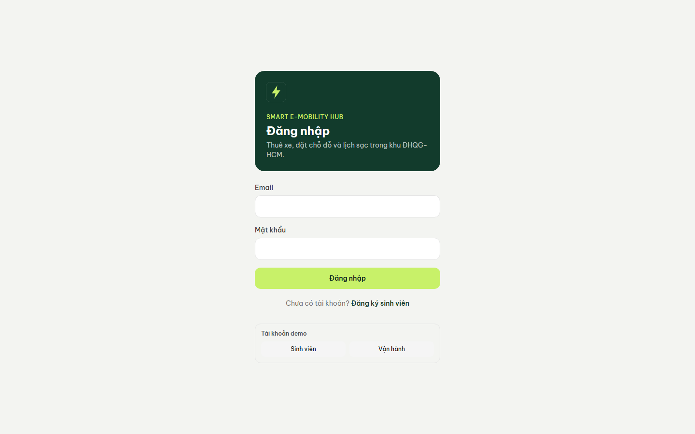
- **Hình 4.1 — Đăng nhập hệ thống (`/login`):** Hỗ trợ đăng nhập theo vai trò (`STUDENT` / `OPERATOR`), tự động điều hướng về đúng không gian làm việc và bảo vệ route theo quyền.

### 2.2. Luồng Sinh viên — Thuê, Nhận & Trả xe dùng chung (UC01 → UC05)
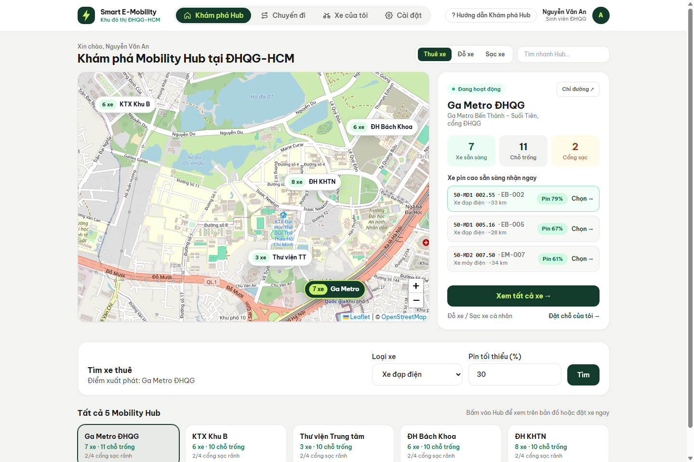
- **Hình 4.2 — Trang chủ Map-First (`/student`):** Hiển thị 5 Mobility Hub trên bản đồ thực tế ĐHQG-HCM với pin số lượng xe/chỗ đỗ/cổng sạc cập nhật mỗi 3 giây. Chọn bất kỳ Hub nào sẽ mở thẻ xem nhanh 3 xe pin cao nhất kèm biển số và nút chỉ đường Google Maps.

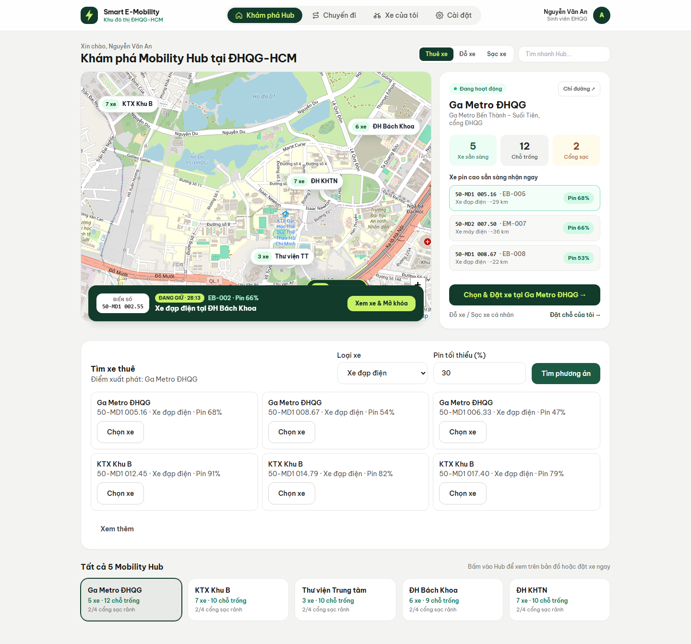
- **Hình 4.3 — Tìm phương án phù hợp (UC01):** Sinh viên chọn mục đích (*Thuê xe / Đỗ xe / Sạc xe*), loại xe và mức pin tối thiểu để hệ thống lọc và điều hướng thẳng sang màn đặt dịch vụ tương ứng.

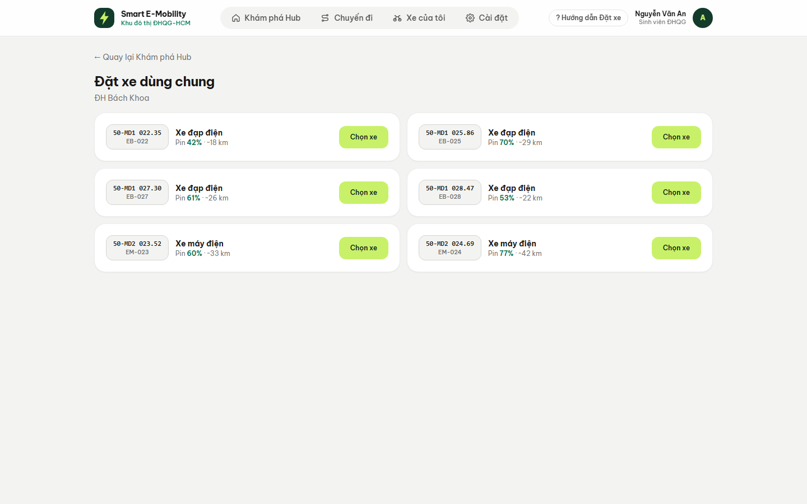
- **Hình 4.4 — Chọn & Đặt xe dùng chung (UC02):** Hiển thị danh sách xe khả dụng kèm biển số, mã xe, % pin và quãng đường ước tính; hỗ trợ xem trước hạn giữ xe 15 phút trước khi xác nhận.

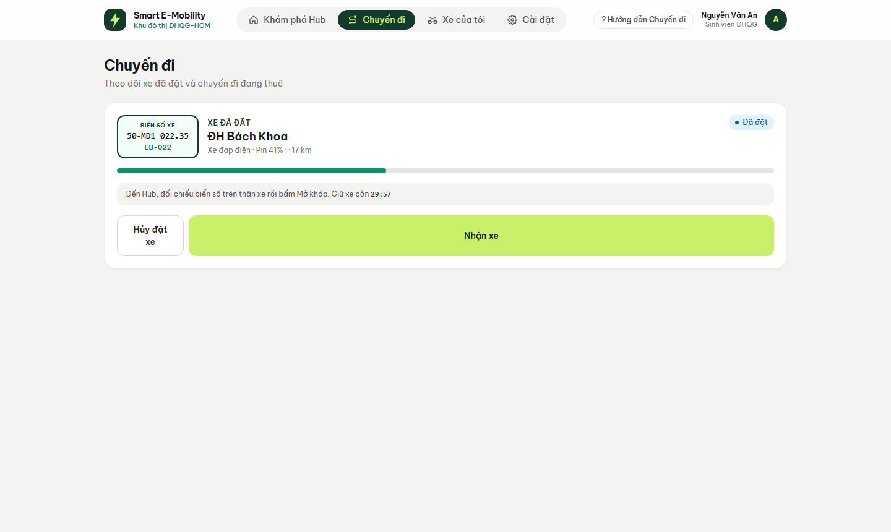
- **Hình 4.5 — Chuyến đi: Mở khóa nhận xe & Trả xe (UC03, UC04, UC05):** Hiển thị nổi bật biển số xe đã đặt, đồng hồ đếm ngược 15 phút, cho phép hủy đặt xe (UC03), mở khóa bắt đầu chuyến đi (UC04) và chọn Hub đích để phân bổ ô đỗ + khóa xe kết thúc chuyến (UC05).

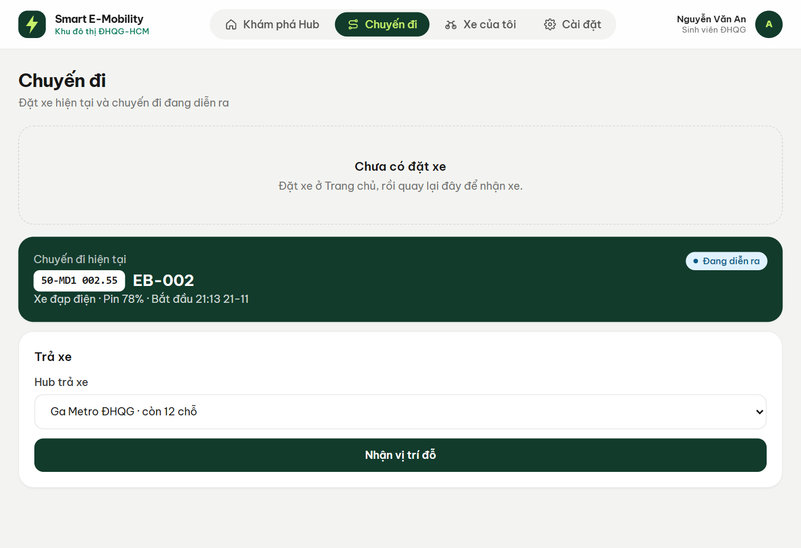

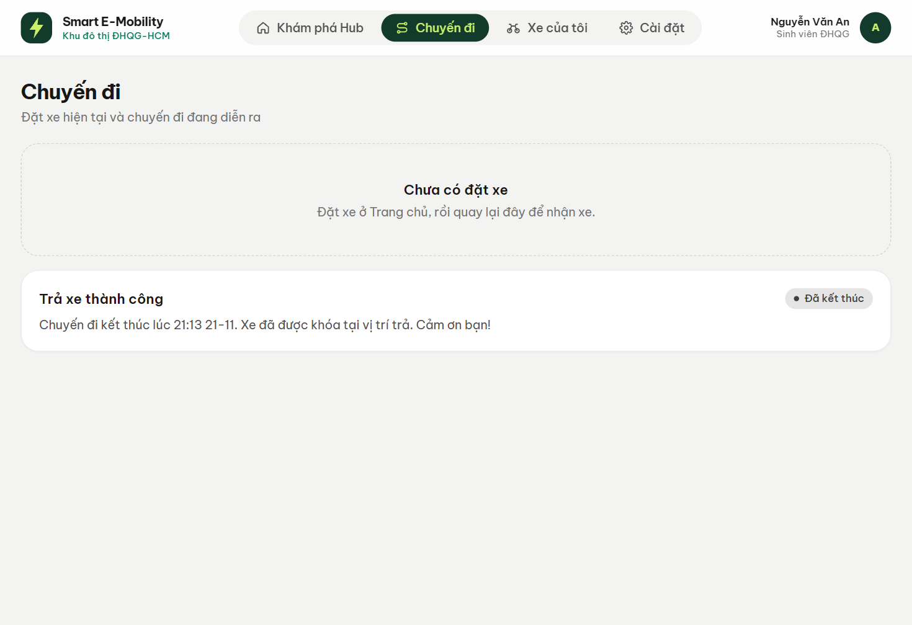

### 2.3. Luồng Sinh viên — Xe cá nhân: Đặt chỗ đỗ & Sạc xe (UC06 → UC09)
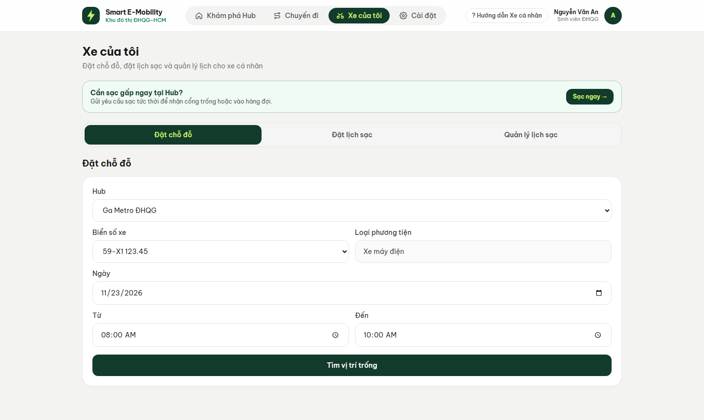
- **Hình 4.6 — Xe của tôi (`/student/my-vehicle`):** Tích hợp 3 luồng cho xe điện cá nhân: (1) Đặt chỗ đỗ theo cơ chế giữ tạm chống tranh chấp (UC06), (2) Đặt lịch sạc trước (UC08), và (3) Xem/đổi khung giờ/hủy lịch sạc đã đặt (UC09).

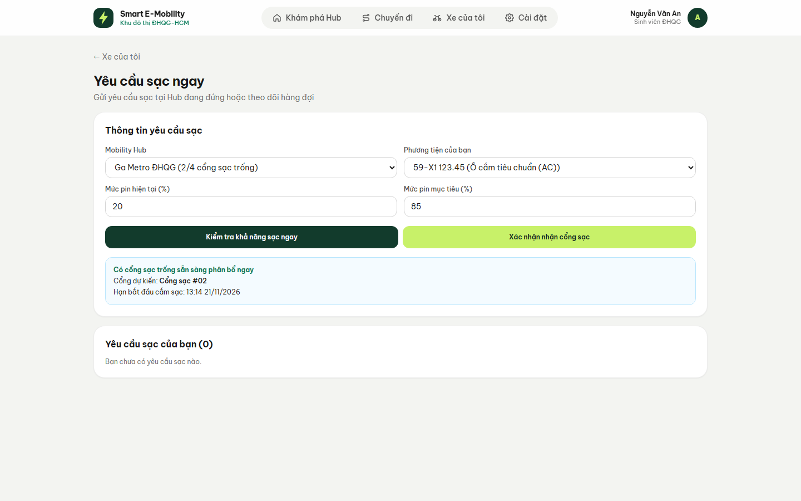
- **Hình 4.7 — Yêu cầu sạc ngay tại Hub (`/student/charging-request`, UC07):** Cho phép kiểm tra cổng sạc trống tức thời hoặc xếp hàng đợi với thời gian chờ ước tính, kèm nút hủy yêu cầu.

### 2.4. Luồng Nhân viên vận hành — Operator Console (UC10 → UC14)
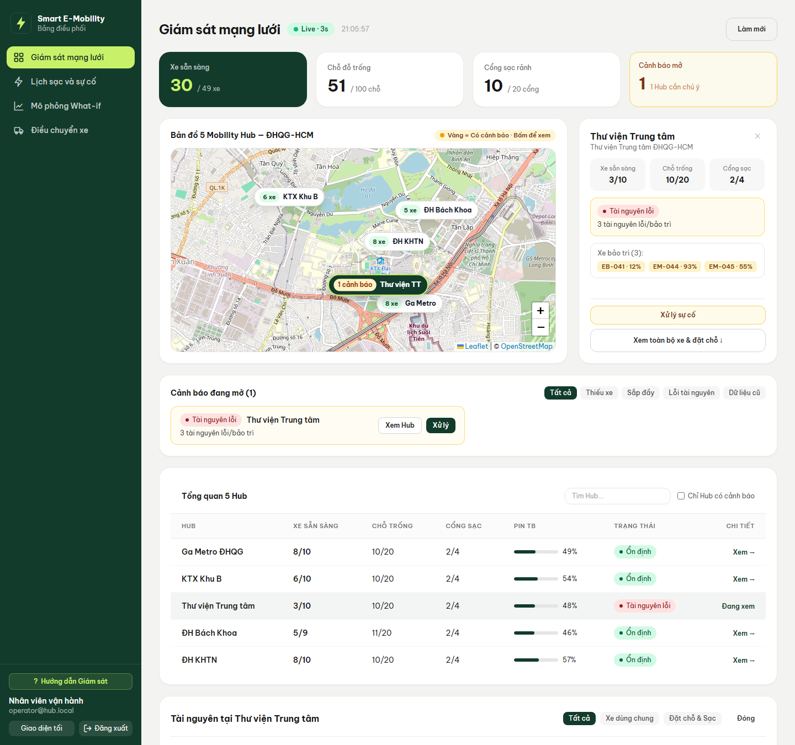
- **Hình 4.8 — Giám sát mạng lưới (`/operator/monitoring`, UC10):** Tổng hợp 4 chỉ số KPI, bản đồ trực quan 5 Hub (tô vàng Hub đang có cảnh báo), danh sách cảnh báo theo ngưỡng (`LOW_VEHICLE`, `NEAR_FULL`, `RESOURCE_FAULT`, `DATA_STALE`) và bảng chi tiết từng Hub cập nhật mỗi 3 giây.

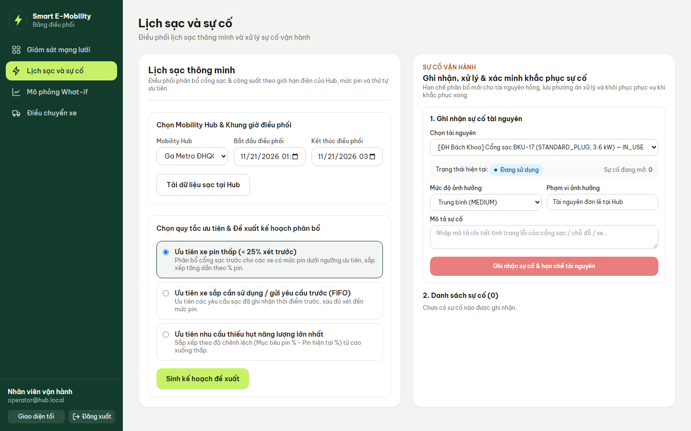
- **Hình 4.9 — Điều phối lịch sạc thông minh & Xử lý sự cố (`/operator/charging-incidents`, UC13 & UC11):** Bên trái hỗ trợ phân bổ cổng sạc cho yêu cầu đang chờ và điều chỉnh lịch khi quá tải; bên phải hỗ trợ ghi nhận sự cố tài nguyên, xử lý đặt chỗ bị ảnh hưởng và đóng sự cố.

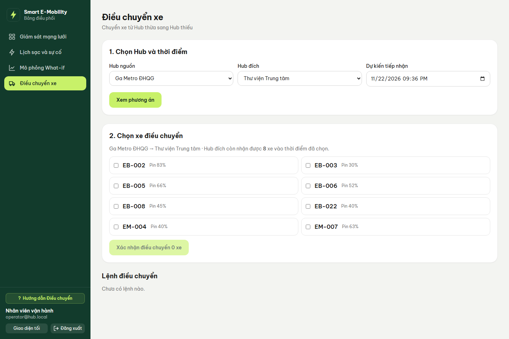
- **Hình 4.10 — Điều chuyển xe (`/operator/redistribution`, UC12):** Tạo lệnh chuyển xe từ Hub dư sang Hub thiếu, theo dõi trạng thái xuất phát – tiếp nhận và đồng bộ sức chứa tại Hub đích với luồng trả xe/đặt chỗ.

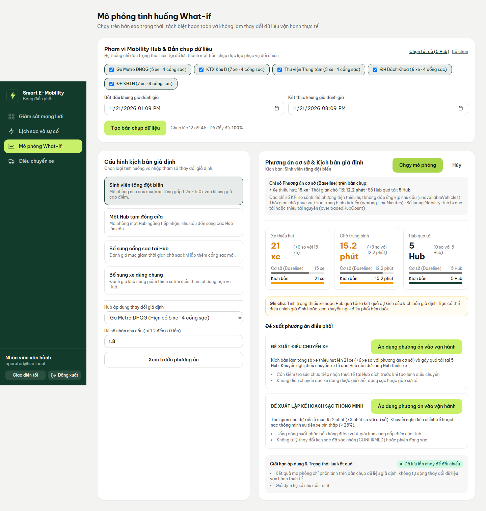
- **Hình 4.11 — Mô phỏng What-if (`/operator/simulation`, UC14):** Chạy kịch bản giả lập tăng nhu cầu hoặc thay đổi phân bổ tài nguyên trên bản chụp hiện tại, so sánh KPI Trước/Sau để hỗ trợ ra quyết định vận hành.

---

## 3. Khai báo sử dụng công cụ GenAI (GenAI Usage Declaration)

Theo quy định của môn học, nhóm khai báo minh bạch việc sử dụng công cụ GenAI trong quá trình phát triển và hoàn thiện dự án:

| Công cụ GenAI | Phạm vi sử dụng | Mức độ đóng góp & kiểm chứng của sinh viên |
|---|---|---|
| **Antigravity (Gemini) / Claude / ChatGPT** | - Hỗ trợ sinh khung code boilerplate (TypeScript/Express/React/Tailwind) theo kiến trúc 4 tầng và chữ ký method nhóm đã thiết kế ở Submission 3. - Hỗ trợ rà soát lỗi nghiệp vụ (race condition giữ sức chứa, idempotency `requestId`, optimistic locking `version`, xử lý Dark Mode CSS). - Hỗ trợ phác thảo giao diện Figma và tích hợp bản đồ Leaflet + OpenStreetMap. - Hỗ trợ rà soát tài liệu, kịch bản demo và checklist kiểm thử. | - **Tỷ lệ hỗ trợ tham khảo:** ~40–50% ở khâu sinh khung code & rà soát lỗi. - **Phần sinh viên tự chủ & chịu trách nhiệm 100%:** phân tích yêu cầu nghiệp vụ (Submission 1), thiết kế luồng màn hình (Submission 2), thiết kế kiến trúc & sơ đồ UML (Submission 3), kiểm thử tích hợp end-to-end trên SQLite và trình duyệt, đánh giá và duyệt từng commit/merge trên GitHub. |
